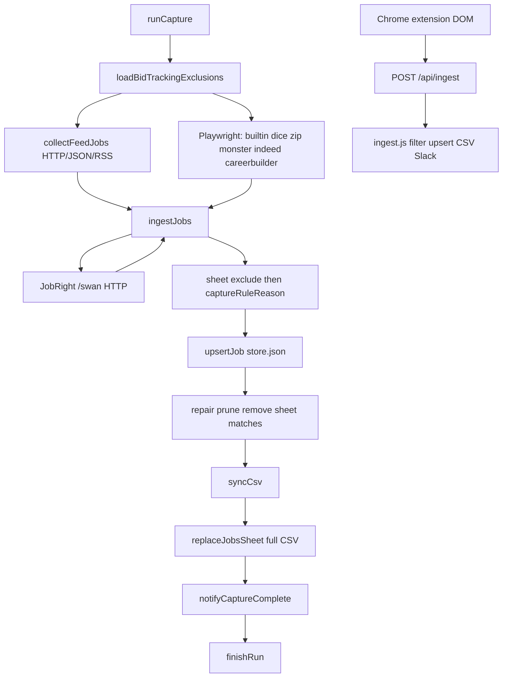

# Architecture

## Data flow

## Dual capture paths

| Path | Entry | Boards | Sheet exclude | Warehouse append | Slack |
|------|-------|--------|---------------|------------------|-------|
| Node API / Playwright / feeds | `src/capture.js` via cron / `npm run capture` / `POST /api/run` | Feeds + Playwright + JobRight `/swan` | Yes | Yes (`newJobs`) | Yes |
| Extension DOM (selectable) | Chrome MV3 `extension/` → `POST /api/ingest` | Indeed, ZipRecruiter, Monster, CareerBuilder, JobRight (in-page `/swan`) | Yes when `excludeBidTracking` (default) | No | Yes |

Paths are independent — enable either or both. Extension popup / Options / `POST /api/extension/capture` select DOM sources; Node `.env` `CAPTURE_*` selects API path sources.

## Capture vs ingest

| Path | Entry | Sheet exclude | Warehouse append | Slack |
|------|-------|---------------|------------------|-------|
| Scheduled / `npm run capture` / `POST /api/run` | `src/capture.js` | Yes | Yes (`newJobs`) | Yes |
| Extension / manual POST | `src/ingest.js` via `server.js` | Optional (`excludeBidTracking`, default on with config) | No | Yes |

## Module map

| Path | Role |
|------|------|
| `src/capture.js` | Orchestrator: enables sources, Playwright, ingest pipeline, CSV/sheet/Slack |
| `src/server.js` | Express + node-cron; triggers capture; extension queue/poll/ingest; CSV export |
| `src/ingest.js` | Extension payload → filter → upsert → CSV (+ Slack); LinkedIn rejected |
| `src/config.js` | dotenv → typed config; board lists; `SOURCE_*`; `CSV_HEADERS` |
| `src/filter.js` | SF relevance, remote/US, blocked employers, LinkedIn ban, `captureRuleReason` |
| `src/store.js` | JSON store; fingerprint dedupe; source prefer; prune; CSV sync |
| `src/csv.js` | RFC4180 write/parse using `CSV_HEADERS` |
| `src/sheet-exclude.js` | Public CSV export of bid-tracker → URL/id exclusion sets |
| `src/sheet-append.js` | POST `appendWarehouse` / `replaceWarehouse` to Apps Script |
| `src/sheet-sync-csv.js` | CLI: local CSV → warehouse (`--replace` supported) |
| `src/browser.js` | Shared UA, launch/context options for Playwright |
| `src/http.js` | `getText` / `getJson` / `tryGetJson` / `postJson` |
| `src/feeds/keep.js` | Shared pre-filter for feed adapters (`keepFeedJob`) |
| `src/ats/map.js` | Greenhouse/Lever/Ashby job shape + `mapPool` concurrency |
| `src/jobright/client.js`, `url.js` | `/swan` API + apply-URL repair |
| `src/dice/search.js`, `detail.js` | Listing stubs → detail scrape |
| `src/slack.js` | Incoming webhook summary of new jobs |
| `apps-script/Code.gs` | Sheet web app: bid-tracker + warehouse actions |
| `extension/` | Selectable DOM capture (Indeed/Zip/Monster/CB) + JobRight; popup/options; → `/api/ingest` |

## Outputs (`DATA_DIR`, default `download/`)

| File | Contents |
|------|----------|
| `jobs_latest.csv` | Combined; newest-first, then source priority; `seq` column |
| `NN_{source}_jobs_latest.csv` | Numbered per `CSV_EXPORT_ORDER` (e.g. `01_builtin_…`) |
| `07_workday_jobs_latest.csv` | Jobs whose apply URL is Workday (any source) |
| `store.json` | Jobs + runs + meta (dedupe history) |

## Playwright pattern

- Single `chromium.launch` per `runCapture` with automation-controlled flag disabled.
- Per board: `browser.newContext(contextOptions())` — fixed Chrome UA, 1400×900, `en-US`.
- Feeds run in parallel with the Playwright path via `feedPromise`.
- Failures in `runNamedSource` warn and continue; they do not abort the run.
- JobRight keeps a browser arg for signature only; real fetch is HTTP in `jobright/client.js`.

## Local API (`npm start`)

| Endpoint | Role |
|----------|------|
| `GET /api/health` | Liveness |
| `GET /api/status` | Last run, CSV paths, source flags |
| `GET /api/jobs?status=new` | Jobs by status |
| `POST /api/run` | Trigger `runCapture` |
| `POST /api/ingest` | Extension posts jobs (`trusted`, `excludeBidTracking`) |
| `POST /api/extension/capture` | Queue extension sources (indeed/zip/monster/cb/jobright) |
| `GET /api/extension/poll` | Extension polls for work |
| `GET /api/extension/status` | Allowed extension sources + queued request |
| `GET /api/export.csv` | Download combined CSV (`?source=` optional) |

Default base: `http://127.0.0.1:3847`.
